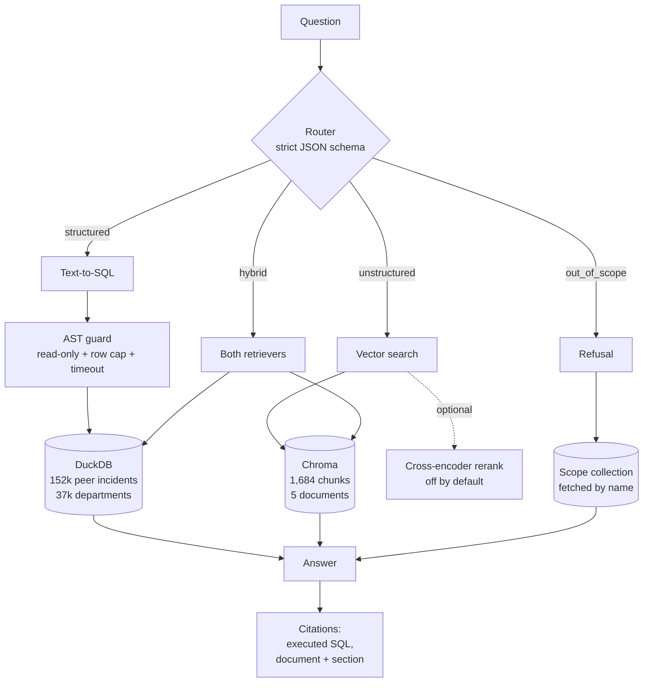

# FireSight RAG

**An evaluation harness that kept contradicting the system it was built to
measure — and, four times, the person building it.**

The larger embedding model lost to the smaller one. The reranker's measured
benefit shrank 2–4× and failed significance once the sample reached 50. The
refusal gate's separation margin inverted from +0.088 to −0.043 when the
question set grew. And a prompt fix written specifically to correct a
percentile bug made the model *more* confidently wrong on the question it was
written for — which was only visible because the question set had been frozen
and committed first.

None of that is the system working badly. It is what measurement is for, and
it is the part of this project worth reading.

Underneath the harness is a hybrid retrieval system: natural-language questions
are routed to **text-to-SQL** over 33.3M NFIRS incident records, to **vector
search** over a public-domain document corpus, to **both**, or **refused with a
citation** when the answer lies in material the corpus deliberately excludes.

> **Scope.** Every figure below is a single measured run with its interval, not
> a best-of. Total model spend across all evaluation: **$3.83**. No further
> scored runs were affordable, so two known defects are documented and
> deliberately left unfixed rather than patched untested — see
> [Known issues / next](#known-issues--next).

---

## Findings

### 1. The system reproduced this project's own tie-handling error, in the opposite direction

Percentile ranking is this project's headline output. Asked *"How does
Sewanee's P90 response time rank against its peer departments?"*, the model
wrote `<=` where the specified rule is midpoint tie handling.

**23 peer departments share Sewanee's 13.0-minute P90**, so the operator is
load-bearing:

| Tie rule | Percentile | Error |
|---|---:|---:|
| strict `<` (optimistic) | 12.9% | −1.5 pts |
| **midpoint (specified)** | **14.4%** | — |
| `<=` (pessimistic) | 15.9% | +1.5 pts |

**3.0 percentage points of spread from one operator** — and this project made
the same class of mistake first, in the other direction: the earliest peer
rankings used strict `<`, placing Sewanee at the top of its own tie group.

A second question, `s24`, showed the bug has a worse face. Asked for a
compliance percentile — where *higher* is better — the model counted
departments with *lower* compliance and returned **91.5% where 8.5% was
correct**. Not a rounding difference; the answer inverted.

Both numbers look completely plausible. 122/768 = 15.9% reads fine next to
14.4%. Nothing here was caught by reading output; it was caught by comparing
against a verified reference.

### 2. A prompt fix that backfired, caught because the set was frozen first

The fix for the above added three rules to the schema description: a rank and a
percentile are different answers, ties use the midpoint, and direction depends
on the metric.

**It corrected `s24` completely** — 91.5% → 8.5%, with the model echoing the
rule back in a code comment. **And it made `s18` worse.** The rule said to give
a percentile *"unless it explicitly asks for a position or a count"*; the model
read *"how does Sewanee's P90 **rank**"* as exactly such a request, and said so:

```sql
/* "Rank" is explicitly requested (an ordinal position, not a percentile). */
```

Pre-fix it returned a rank with the wrong tie rule. Post-fix it returns a rank,
a tie count and a pool size with **no percentile at all** — better tie handling,
more confident about the wrong output shape.

**Instruction specificity cut against intent**, and the only reason that is
visible is that the 42 questions and their references were hashed and committed
*before* any code changed. A fix measured against a set written afterwards would
have shown the s24 win and hidden the s18 loss.

### 3. Semantics and exact match disagree, and the gap is the measurement

Post-fix, the `percentile_vs_rank` category is **4/4 correct on semantics** and
**2/4 on exact match**. Both remaining failures return the right number with
extra context columns — asked for a percentile, the model returns the
percentile *and* the pool size.

That gap is a property of the scorer, not the model. It is reported rather than
designed away: exact match stays primary precisely because the alternative
flatters the system.

### 4. A reasoning block will silently eat the entire token budget

The router showed a **21.7% schema-violation rate** with replies that were empty
or truncated mid-string. That reads as a model unable to follow an output
schema. It was not. Reproduced with two direct API calls:

| `max_tokens` | `stop_reason` | content blocks | text |
|---|---|---|---|
| 300 | `max_tokens` | `['thinking']` | `''` |
| 1000 | `end_turn` | `['thinking', 'text']` | valid JSON |

The reasoning block alone exceeded 300 tokens, so the budget was exhausted
before any text existed. **It was depressing three metrics at once:**

| Metric | With the bug | Fixed |
|---|---:|---:|
| Router accuracy | 84.8% | **95.7%** |
| Router schema violations | 21.7% | **0.0%** |
| Answer faithfulness | 11/13 | **13/13** |

Faithfulness moved because a truncated answer stops mid-sentence, and a judge
correctly reads an unfinished claim as unsupported.

### 5. FDID is not a national key, and the published cohort was wrong

NFIRS department IDs are unique only *within* a state. The prior analysis of
this data joined on `fdid` alone, which pulled **3,088,042 incident rows from
2,390 unrelated departments across 43 states** into the peer cohort — about
twenty times the legitimate 151,759 rows.

| Figure | Previously published | Corrected |
|---|---:|---:|
| Peer departments identified | — | 1,568 |
| Reporting in 2024 | 1,233 | 936 |
| **Benchmarkable cohort** | **1,138** | **768** |

Sewanee's own figures survived — incident count, median, P90 and call mix all
reconcile exactly — because FDID `26161` happens to be nationally unique. The
peer figures did not.

The corrected regional P90 percentile is **14.4%**, better than the **29%**
originally published. Both halves of that sentence matter: it is better, *and*
it is computed against a materially different cohort, so it is not a
like-for-like improvement.

---

## Metrics

Every proportion carries a **Wilson 95% interval**; means carry a
normal-approximation interval. The harness emits them, so a point estimate
cannot be reported alone.

### Text-to-SQL — n=42

| Metric | Pre-fix | Post-fix |
|---|---|---|
| Execution accuracy | 42/42 = 100.0% [91.6, 100.0] | 42/42 = 100.0% [91.6, 100.0] |
| **Exact row match — PRIMARY** | 24/42 = 57.1% [42.2, 70.9] | **25/42 = 59.5% [44.5, 73.0]** |
| Answer containment — secondary | 34/42 = 81.0% [66.7, 90.0] | 36/42 = 85.7% [72.2, 93.3] |

**The post-fix change is not significant.** Two questions fixed, one regressed,
paired sign test **p = 1.000**. Reading 57.1% → 59.5% as an improvement is
reading noise.

### Retrieval — n=50

| Arm | Recall@5 (95% CI) | MRR (95% CI) | p50 |
|---|---|---|---:|
| bge-small / small + rerank | 0.850 [0.756, 0.944] | 0.712 [0.607, 0.817] | 2,366 ms |
| bge-small / default + rerank | 0.840 [0.741, 0.939] | 0.670 [0.563, 0.777] | 4,338 ms |
| bge-small / small | 0.820 [0.716, 0.924] | 0.613 [0.499, 0.727] | **26 ms** |
| bge-small / default | 0.795 [0.687, 0.903] | 0.601 [0.490, 0.713] | 26 ms |
| bge-base / small + rerank | 0.800 [0.692, 0.908] | 0.646 [0.534, 0.757] | 2,464 ms |
| bge-base / default + rerank | 0.750 [0.634, 0.866] | 0.602 [0.489, 0.715] | 4,593 ms |
| bge-base / small | 0.740 [0.620, 0.860] | 0.632 [0.513, 0.752] | 52 ms |
| bge-base / default | 0.735 [0.614, 0.856] | 0.619 [0.495, 0.743] | 53 ms |

**Headline: external Recall@5 = 0.821, not the pooled 0.850.** Eight of the 50
questions are answered by this project's own methodology document and score a
perfect 1.000 on every arm. Pooling them inflates the figure, so the two are
always reported apart.

**`bge-small` wins.** It beats `bge-base` on Recall@5 in all four paired
comparisons, at half the query latency (26 ms vs 52 ms) and half the vector size
(384 vs 768 dimensions). No single comparison is significant — every interval
pair overlaps — but four of four in the same direction, with no cost argument
for the alternative, settles it. A negative result for the obvious upgrade.

**The reranker is not established.** Paired comparison on the same 50 questions:

| Config | ΔRecall@5 | ΔMRR | improved / worsened | sign test |
|---|---|---|---:|---:|
| default | +0.045 [0.000, 0.101] | +0.071 [0.000, 0.169] | 16 / 9 | p = 0.230 |
| small | +0.030 [0.000, 0.082] | +0.099 [0.009, 0.189] | 14 / 5 | p = 0.064 |

At n=15 the same measurement gave +0.100 and +0.133 — **2–4× larger than the
truth**. Neither sign test reaches p < 0.05. With a 90× latency cost the
reranker ships **off by default** (`FIRESIGHT_RERANK=1`).

### Router — n=46

| Metric | Result |
|---|---|
| Accuracy | 44/46 = 95.7% [85.5, 98.8] |
| Macro F1 | 0.956 |
| Schema-violation rate | 0/46 = 0.0% [0.0, 7.7] |
| **Adversarial excluded-material** | **8/8 = 100.0% [67.6, 100.0]** |
| Adversarial exclusion-reason | 8/8 = 100.0% [67.6, 100.0] |

| Route | Precision | Recall |
|---|---|---|
| structured | 11/11 = 100.0% [74.1, 100.0] | 11/12 = 91.7% [64.6, 98.5] |
| unstructured | 12/13 = 92.3% [66.7, 98.6] | 12/12 = 100.0% [75.8, 100.0] |
| hybrid | 9/9 = 100.0% [70.1, 100.0] | 9/10 = 90.0% [59.6, 98.2] |
| out_of_scope | 12/13 = 92.3% [66.7, 98.6] | 12/12 = 100.0% [75.8, 100.0] |

**8/8 is not a rate.** Its interval spans [67.6%, 100.0%] — 32 points. The
correct reading: the design assumption that a router can be *told* the
excluded-material distinction, where embedding similarity provably cannot make
it, is supported by every case tested, and the sample is far too small to claim
a rate.

### Generation — n=13 judged

| Metric | Result |
|---|---|
| Faithfulness (zero unsupported claims) | 13/13 = 100.0% [77.2, 100.0] |
| Citation rate | 13/13 = 100.0% [77.2, 100.0] |
| Citation validity (page-insensitive) | 13/13 = 100.0% [77.2, 100.0] |
| Refused (correctly, no support) | 2/15 |

100% at n=13 bottoms out at **77.2%**. It is evidence, not a rate.

### Benchmark output

Sewanee Fire Department against 768 peer departments (Pool B), midpoint ties:

| Metric | Percentile |
|---|---:|
| P90 response time, regional | 14.4% |
| P90 response time, Tennessee | 10.5% |
| 8-minute compliance, regional | 8.5% |
| 8-minute compliance, Tennessee | 6.5% |

Sewanee's P90 is 13.0 min against a peer median of 18.0 min.

---

## Limitations

Stated plainly, because each one bounds what the numbers above mean.

**Self-reference inflates retrieval.** Eight of 50 questions are answered by
this project's own methodology document and score **1.000 on every arm**
against **0.821** for the 42 external questions. That gap narrowed as the
external set grew and **will not close** — a short, cleanly sectioned document
written in the same register as the questions is an easy target. The split is
always reported; the methodology share is capped at 16%.

**Faithfulness is judged by the same model family that wrote the answers.**
Claude judging Claude. The judge sees only the retrieved passages and the
answer, never the label or the expected answer, so it cannot grade correctness
by accident — but shared failure modes between generator and judge would not
show up here. An independent judge is the right fix and was not affordable.

**The refusal floor is the wrong instrument.** It worked at n=15 with a +0.088
separation margin. At n=50 the margin **inverted to −0.043**: in-corpus
questions bottom out at 0.619, below the out-of-corpus ceiling of 0.662. No
threshold separates them. Two in-corpus questions are now wrongly refused
(`d14`, `d31`) and lowering the floor to rescue one would admit three
out-of-corpus questions. The clean separation was a small-sample artifact.
**The router's explicit out-of-scope path replaces it** — 8/8 adversarial, with
no threshold at all.

**n is small throughout.** 42 SQL questions, 50 retrieval, 46 routing, 13
faithfulness, 8 adversarial. Most intervals span 20–40 points. The reranker
result is the cautionary case: at n=15 it looked like a clear win and at n=50 it
failed significance.

**Containment was defined after seeing exact match score 45%.** It is reported
because it measures something real, labelled post-hoc because it was invented
in response to a result, and kept **secondary** — including at the point in M5
where it moved further than the primary metric and would have told a better
story.

**`r12` and `r27` are a known labeling ambiguity.** Both may be label error
rather than model error. They are **frozen as written**, because revising a
label after seeing model output is the same post-hoc problem as inventing a
metric after seeing a result. 95.7% stands under the labels as written; if
either label is wrong the true accuracy is higher.

**The benchmarkable cohort is not a random sample.** Peer criteria require
staffing fields blank for 42–63% of departments, so only the ~37% that file
complete administrative data can be evaluated — and departments diligent about
paperwork plausibly differ from those that are not.

### Three process decisions worth naming

1. **The baseline was committed before any code changed.** The 42 questions and
   their references were hashed into `eval/m5_frozen_set.json` first. That is
   the only reason the s18 backfire was visible rather than silently absorbed.
2. **Exact match was not loosened** when doing so would have converted 10
   failures into passes — because it would have collapsed the primary metric
   into the secondary one and left the project with two names for one number.
3. **Containment stayed secondary** at exactly the moment it told a better
   story. Promoting a post-hoc metric when it starts winning is how an
   evaluation stops being one.

---

## Known issues / next

Both need a scored run to validate, and the measurement budget is spent.
Untested edits layered on top of measured numbers would be worse than clean
unfixed ones, so they are documented rather than patched.

- **The s18 prompt wording.** "Rank" and "compare" in a question about a
  department's standing must both resolve to *percentile*; a positional answer
  belongs only where a question asks how many departments are faster (which
  `s22` asks, and the model already answers correctly). The current wording
  invites the opposite reading.
- **Three over-specified references.** `s17`, `s19` and `s20` select more
  columns than their questions ask for — `s17` asks which peer group Sewanee is
  in and its reference returns four columns. Either narrow the references or
  widen the questions, then re-score. Until then these three are expected to
  keep failing exact match, and that is the measurement working correctly on
  badly specified questions.

---

## Architecture



The `out_of_scope` path fetches the scope document **by name** rather than
hoping it ranks — measured, it does not reach the top 5 for the NFPA-13
question, the same similarity blindness that lets that question past the floor.

Three independent layers keep generated SQL read-only: sqlglot AST inspection,
an injected row cap, and a `read_only` connection under an interrupt timeout.
40 adversarial tests cover statement smuggling, `PRAGMA`/`SET`/`INSTALL`, and
filesystem table functions.

---

## Setup

Requires [uv](https://docs.astral.sh/uv/). It fetches its own Python 3.12 — the
project pins `>=3.11,<3.13` because `torch` has no 3.13+ wheels.

```bash
uv sync --extra rag --extra llm
```

```bash
cp .env.example .env
```

Edit `.env`: add `ANTHROPIC_API_KEY`, and point `FIRESIGHT_NFIRS_DIR` and
`FIRESIGHT_LOCAL_INCIDENTS` at your copies of the source data. None of it is
redistributable through this repo; `data/PROFILE.md` documents how to obtain it.

```bash
uv run pytest
```

Build the stores (DuckDB ~30 s; Chroma ~15 min, local embeddings):

```bash
uv run python -m firesight.ingest.structured
```

```bash
uv run python -m firesight.ingest.documents --clean
```

Use `--clean`, not `--rebuild`. Chroma's `delete_collection` leaves the HNSW
segment directory behind, and repeated rebuilds accumulate orphans — measured
here at 14 segment directories and 131 MB for what should be 4 collections.

Ask it something:

```bash
uv run python -m firesight.generation.answer "What was Sewanee's P90 response time in 2024?"
```

Reproduce the measurements (needs an API key; ~$1.50 for all four):

```bash
uv run python scripts/verify_reference_sql.py
```

```bash
uv run python -m firesight.eval.sql_suite
```

```bash
uv run python -m firesight.eval.router_suite
```

```bash
uv run python -m firesight.eval.faithfulness_suite
```

```bash
uv run python -m firesight.eval.retrieval_suite --k 5
```

Local-only checks, no API key:

```bash
uv run python scripts/compare_embedding_models.py --k 5
```

```bash
uv run python scripts/calibrate_support_floor.py
```

```bash
bash scripts/secret_scan.sh
```

---

## Data sources and licensing

**Structured.** NFIRS 2024 Public Data Release (U.S. Fire Administration) —
33,312,139 incidents, all of calendar 2024, and 37,122 departments. Public
domain, ~12 GB extracted, **not committed**. Obtain from
<https://www.usfa.fema.gov/nfirs/public-data-release/>.

**Structured, local.** One department's own incident export, 197 records,
2025-09 to 2026-03, carrying the dispatch → en-route → on-scene chain NFIRS
lacks. **Not redistributable** and not in the corpus: it holds street addresses,
building names, coordinates and personnel identifiers. Aggregate metrics derived
from it may be published; the records may not. A test enforces this.

**Documents.** NFIRS 5.0 Complete Reference Guide, Design Documentation, Fire
Data Analysis Guidelines, and the PDR code dictionary — all USFA/FEMA works,
public domain under 17 U.S.C. §105. Plus this project's own frozen methodology
document, SHA-256 pinned.

**NFPA standards are copyrighted and are never ingested.** Where a compliance
threshold is relevant, it is cited by standard number only, and the router
refuses questions whose answers live in that text.

Corpus membership is an explicit allowlist (`CORPUS_MANIFEST`), not a directory
glob. Build artifacts — `PROFILE.md`, `RECONCILIATION.md`, this README,
`eval/results/` — are denylisted and tested from both directions, after an
earlier version of them in the corpus made retrieval metrics a function of how
much documentation had been written.

Code is MIT licensed.

---

## Repository map

| Path | What it is |
|---|---|
| [`data/PROFILE.md`](data/PROFILE.md) | Data profile: schemas, null rates, nine known quality defects |
| [`data/RECONCILIATION.md`](data/RECONCILIATION.md) | Rebuilt figures vs prior published output |
| [`data/M5_BASELINE.md`](data/M5_BASELINE.md) | Pre-fix SQL baseline, committed before any fix |
| [`data/M5_RESULTS.md`](data/M5_RESULTS.md) | Pre/post comparison, including the backfire |
| [`data/corpus/METHODOLOGY.md`](data/corpus/METHODOLOGY.md) | Frozen methodology, in the corpus |
| [`data/corpus/SCOPE.md`](data/corpus/SCOPE.md) | What the corpus excludes and why |
| [`eval/`](eval/) | Question sets, verified references, committed reports |
| [`src/firesight/eval/stats.py`](src/firesight/eval/stats.py) | Wilson and mean intervals |
| [`src/firesight/retrieval/sql_guard.py`](src/firesight/retrieval/sql_guard.py) | Read-only enforcement |
